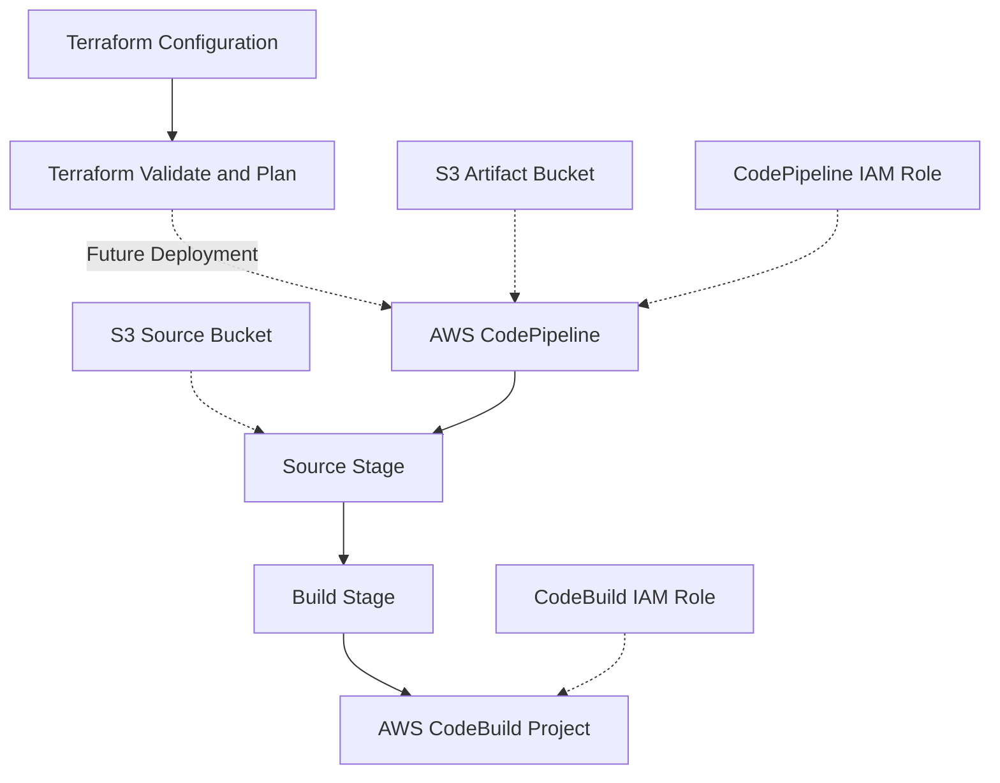

# AWS CodePipeline Terraform Lab

## Project Overview

This project demonstrates how to use Terraform, AWS CLI, Ubuntu Linux, and Git to plan a two-stage AWS CodePipeline that connects Amazon S3 with AWS CodeBuild.

**Project status: PLAN ONLY — no AWS resources deployed.**

## Architecture



All AWS resources shown are planned, not deployed.

## Technologies

- AWS CodePipeline
- AWS CodeBuild
- Amazon S3
- AWS IAM
- AWS CLI
- Terraform 1.17.0
- Ubuntu Linux
- Git and GitHub

## Planned Infrastructure

Terraform plans 13 AWS resources:

| Resource | Purpose |
|---|---|
| `aws_s3_bucket.artifacts` | Pipeline artifact storage |
| `aws_s3_bucket_public_access_block.artifacts` | Block public access |
| `aws_s3_bucket_server_side_encryption_configuration.artifacts` | S3 encryption |
| `aws_s3_bucket.source` | Application source storage |
| `aws_s3_bucket_public_access_block.source` | Block public access |
| `aws_s3_bucket_server_side_encryption_configuration.source` | S3 encryption |
| `aws_s3_bucket_versioning.source` | Enable source versioning |
| `aws_iam_role.pipeline` | CodePipeline service role |
| `aws_iam_role_policy.pipeline` | Pipeline permissions |
| `aws_iam_role.build` | CodeBuild service role |
| `aws_iam_role_policy.build` | Build permissions |
| `aws_codebuild_project.lab` | Build project |
| `aws_codepipeline.lab` | Two-stage pipeline |

## Pipeline Stages

**Source:** Reads `application.zip` from the planned S3 source bucket.

**Build:** Uses the planned CodeBuild project to run a simple demonstration buildspec.

No source ZIP file has been uploaded and no build has been executed.

## AWS Discovery

The AWS CLI returned:

```json
{
  "pipelines": []
}
```

The CodePipeline count was zero in `us-east-1`.

## Terraform Validation

Commands:

```bash
terraform init
terraform fmt
terraform validate
terraform plan -input=false -no-color
```

Observed results:

```text
Success! The configuration is valid.

Plan: 13 to add, 0 to change, 0 to destroy.
```

## Deployment Status

No `terraform apply` was executed.

No S3 buckets, CodeBuild projects, IAM roles, or CodePipeline pipelines were created by this lab.

## Security and Cost

- S3 buckets are configured with public access blocking and SSE-S3 encryption.
- Source bucket versioning is enabled in the plan.
- Terraform state and variable files are excluded from Git.
- No AWS credentials or private keys should be committed.
- IAM permissions require further review and tightening before production use.
- S3 storage, CodeBuild execution, and CodePipeline usage may incur charges.

## Future Improvements

- Deploy to a dedicated test environment after authorization.
- Upload an application ZIP file.
- Restrict IAM permissions to the minimum required.
- Configure event-based source change detection.
- Add automated tests.
- Integrate a deployment stage using CodeDeploy.
- Validate a complete CI/CD workflow.

## Validation Evidence

See `docs/validation-evidence.md` and `screenshots/codepipeline-terraform-validation.png`.

